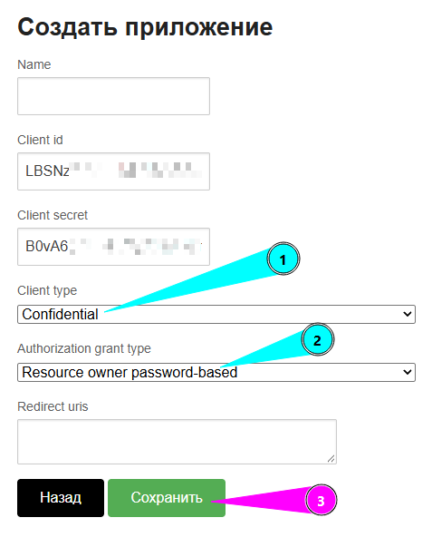

# Stepik Course Backup

Скрипт `main.py` скачивает один курс Stepik в структуру папок.
Для каждого шага сохраняются два файла:

- `*.md` — удобная для чтения версия: текст, варианты ответов и числовые ответы;
- `*.json` — полный исходный ответ API Stepik (`step-source`).

## Дополнительно

- [StepKit: публикация курсов на Stepik](STEPKIT_DEPLOY.md) — отдельный
  инструмент и бесплатный курс о загрузке уроков на Stepik через API.

## Установка

Требуется Python 3. Установите зависимости:

```bash
pip install requests python-dotenv
```

## Настройка

Создайте в папке со скриптом файл `.env`:

```env
# Откройте https://stepik.org/oauth2/applications/ и создайте приложение.
# Client type: Confidential
# Authorization grant type: Resource owner password-based
# Redirect URI не нужен.
STEPIK_CLIENT_ID=ваш_client_id
STEPIK_CLIENT_SECRET=ваш_client_secret

# Учётная запись Stepik с доступом к курсу.
STEPIK_USERNAME=почта_аккаунта_stepik
STEPIK_PASSWORD=пароль_аккаунта_stepik

# Обычно менять не нужно.
STEPIK_API_HOST=https://stepik.org

# ID нужного курса из URL: https://stepik.org/course/272771
STEPIK_COURSE_ID=272771

# true — не перезаписывать шаги, для которых уже есть и .md, и .json.
STEPIK_SKIP_EXISTING=true

# Необязательные настройки производительности.
STEPIK_MAX_WORKERS=8
STEPIK_BATCH_SIZE=5
```

### Создание OAuth-приложения



1. Откройте <https://stepik.org/oauth2/applications/> под тем же аккаунтом,
   которому доступен курс, и создайте приложение.
2. В поле **Client type** выберите **Confidential**.
3. В поле **Authorization grant type** выберите
   **Resource owner password-based**.
4. Поле **Redirect URI** оставьте пустым: оно требуется для потоков
   Authorization code и Implicit, но этот скрипт их не использует.
5. После сохранения скопируйте значения **Client ID** и **Client secret** в
   `STEPIK_CLIENT_ID` и `STEPIK_CLIENT_SECRET`.

Скрипт использует парольный OAuth-поток: отправляет ID и секрет приложения,
логин и пароль из `.env` на Stepik и получает токен для этого аккаунта.
Учётная запись должна иметь доступ к курсу. Не добавляйте `.env` в Git и не
публикуйте его: в нём находятся пароль и секрет OAuth-приложения.

## Запуск

Из папки со скриптом:

```bash
python3 main.py
```

Папка результата формируется автоматически как `stepik_course_<ID курса>`
относительно папки запуска. Например, при `STEPIK_COURSE_ID=272771`:

```text
Папка для сохранения: /полный/путь/stepik_course_223717
```

## Что происходит во время работы

Сначала скрипт получает **метаданные** курса: разделы, уроки и список шагов.
На этом этапе файлов ещё нет — это видно по строкам вида:

```text
Метаданные step: 1-5 из 12
```

После строки:

```text
Начинаю сохранение файлов. Параллельных воркеров: 8.
```

начинается скачивание содержимого и запись файлов:

```text
saved путь/к/файлу.md
skip  путь/к/файлу.md
```

- `saved` — шаг получен с Stepik и записан;
- `skip` — оба файла уже существуют, поэтому шаг не скачивался повторно.

Итоговый лог показывает отдельное количество сохранённых и пропущенных шагов.

## Повторный запуск

При `STEPIK_SKIP_EXISTING=true` скрипт продолжает незавершённую выгрузку и не
перезаписывает уже готовые пары `.md`/`.json`.

Чтобы пересоздать все файлы, установите:

```env
STEPIK_SKIP_EXISTING=false
```

## Обработка временных ошибок Stepik

Скрипт повторяет GET-запросы при ответах `429`, `500`, `502`, `503`, `504` с
увеличивающейся паузой. Списки ID запрашиваются небольшими пакетами, чтобы
снизить вероятность ошибки `504 Gateway Time-out`.

Если Stepik вернул `401`, токен обновляется автоматически. Ошибка `403` обычно
означает, что указанный аккаунт не имеет доступа к закрытому курсу.

## Структура результата

```text
stepik_course_223717/
└── 223717 Название курса/
    └── 01 Название раздела/
        └── 01 Название урока/
            ├── 123456_01_text.md
            └── 123456_01_text.json
```
